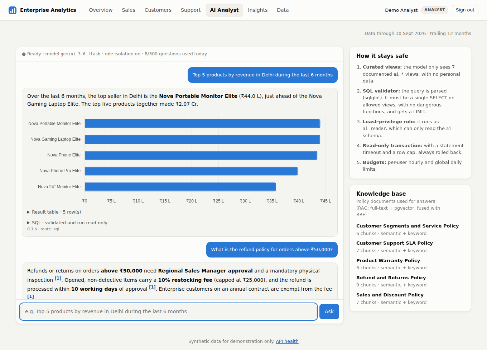
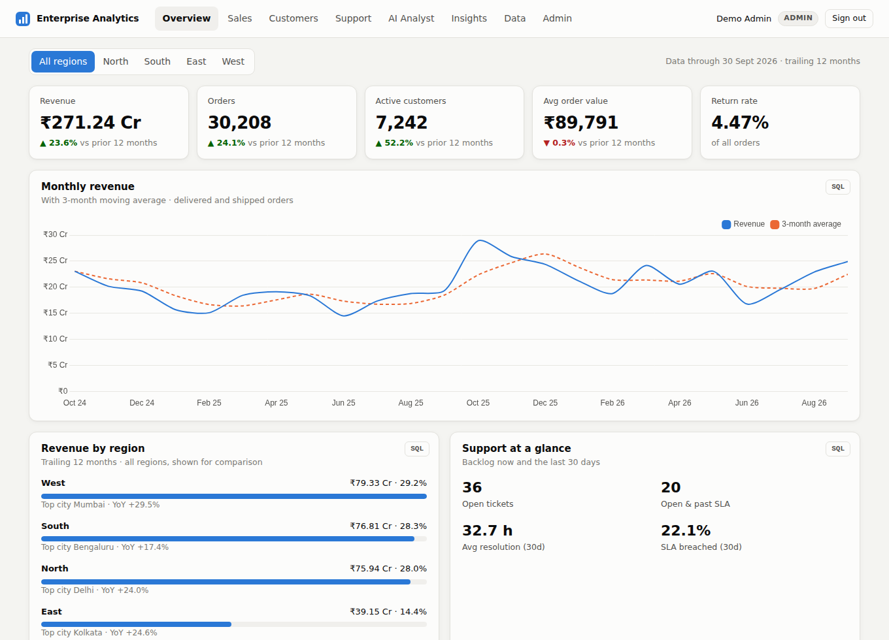
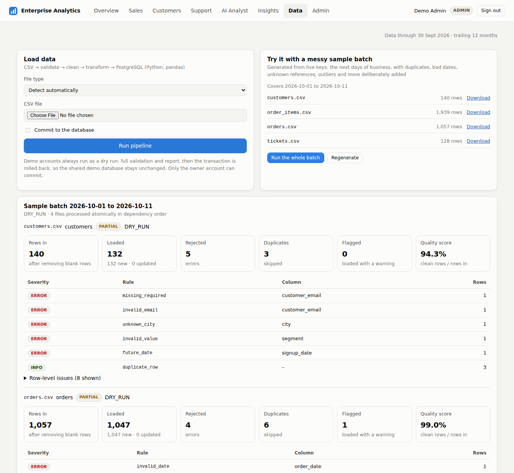
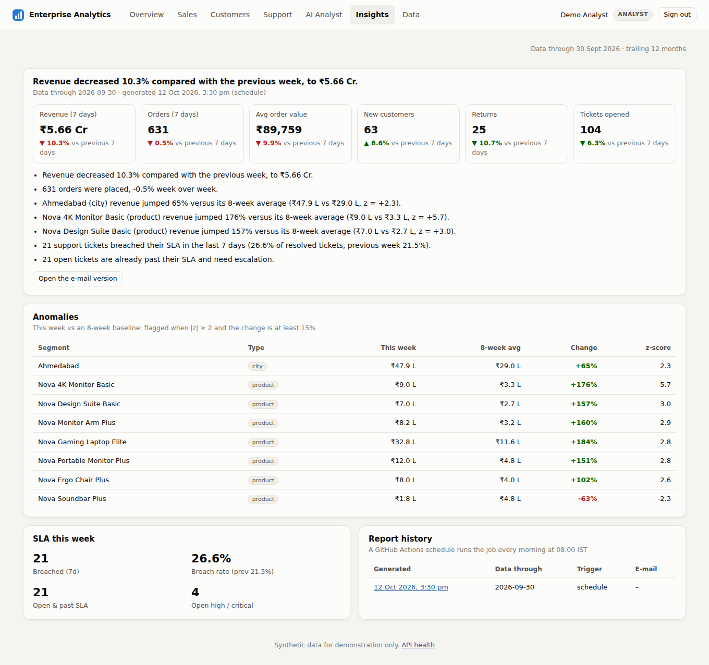
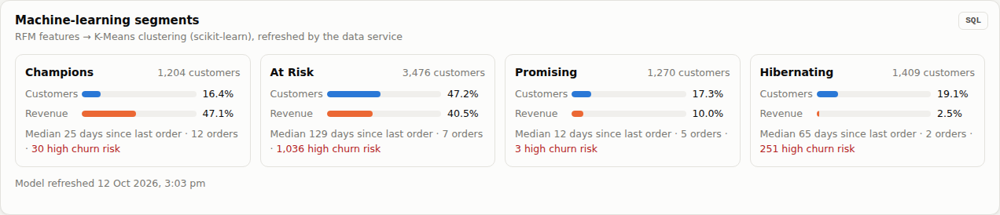
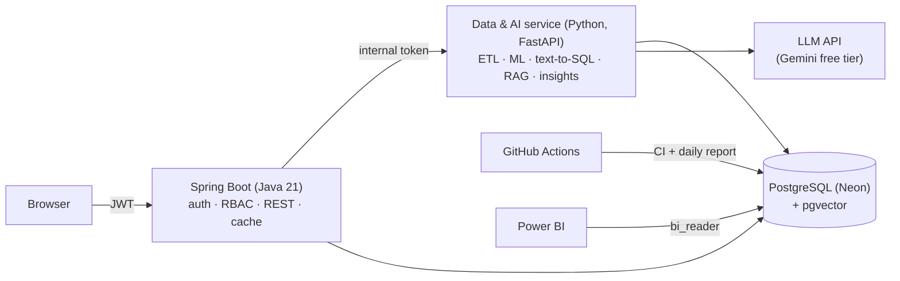

# Enterprise Analytics Platform

**Operations intelligence with an AI data analyst.** It combines a Spring Boot API and live dashboards with a Python data
platform: a data-quality-checked ETL pipeline, machine-learning customer segments, natural-language → SQL,
RAG over company policies, and a daily anomaly report by e-mail.

**Live demo:** `https://enterprise-analytics.onrender.com`. Pick a role. **Analyst** sees the SQL behind every chart, and **Admin** can run the ETL pipeline.
*It's on a free tier, so the first load after a quiet period takes about a minute.*

[](https://github.com/dev270303/enterprise-analytics-platform/actions/workflows/ci.yml)



| | |
|---|---|
|  |  |
|  |  |

---

## What it does

A synthetic company sells electronics and office equipment across **17 Indian cities in 4 regions**. It has 24 months of history:
about 8,000 customers, 60,000 orders, 110,000 order lines and 9,500 support tickets, with growth, festive peaks and weekday effects.

| Phase | Feature | Highlights |
|---|---|---|
| 1 | **Dashboards + REST API** | Java 21 / Spring Boot 3, JWT, 16 analytical SQL queries (CTEs, window functions, cohort retention, percentiles), region filters, Flyway |
| 2 | **ETL pipeline** | CSV → validate → clean → transform → PostgreSQL (pandas). Idempotent upserts, atomic batches, dry runs, a data-quality score and a row-level issue report |
| 2 | **Machine learning** | RFM features → K-Means (scikit-learn), named segments, a churn-risk indicator and a churn watchlist |
| 2 | **BI layer** | star schema (`bi.fact_*`, `bi.dim_*`) for Power BI, with a read-only login and DAX measures ([guide](docs/POWERBI.md)) |
| 3 | **AI data analyst** | question → LLM → SQL → **validated** → run **read-only** → chart + plain-English answer, with one self-correction retry on errors |
| 3 | **RAG** | policy documents → chunks → **pgvector** embeddings + full-text search, fused with Reciprocal Rank Fusion. Answers cite their sources |
| 4 | **Automated insights** | z-score anomaly detection vs an 8-week baseline, SLA monitoring, an HTML e-mail, and a GitHub Actions schedule at 08:00 IST |
| 4 | **Security & delivery** | 4 roles (ADMIN / ANALYST / MANAGER / EMPLOYEE), owner vs demo accounts, rate limits, Docker Compose, CI on every PR, deploy only after CI passes |

## Architecture



The browser only talks to Java, which owns users, roles and rate limits. Python does the data science and AI work.
**Flyway owns the whole schema.** Python tests build their database from the same migration files.
Details: **[docs/ARCHITECTURE.md](docs/ARCHITECTURE.md)** · API: **[docs/API.md](docs/API.md)**

## How the AI analyst stays safe

Generated SQL passes through six independent layers. Any one of them failing closed stops a harmful query:

1. **Curated surface:** the model only sees 7 documented, PII-free `ai.*` views.
2. **AST validation** (sqlglot): exactly one `SELECT`, only whitelisted views, no `pg_*` / `dblink` / `set_config` functions, no `INTO` or locking, and a `LIMIT` is enforced.
3. **Least-privilege role:** it runs as `ai_reader`, which can only `SELECT` from the `ai` schema (`SET LOCAL ROLE`).
4. **Read-only transaction**, always rolled back.
5. **Resource limits:** `statement_timeout` and a row cap.
6. **Budgets:** per-user hourly limit (Java) and a global daily limit (Python).

Each layer has tests. For example, `test_readonly_role_blocks_private_tables` proves that even SQL that bypasses the validator can't read `app_users`.
With no LLM key configured, policy questions still work (keyword search plus extractive answers).

## Roles

| Role | Sees | Can do |
|---|---|---|
| **MANAGER** | dashboards, AI analyst, insights | ask questions |
| **ANALYST** | + SQL behind every chart, data-quality reports | |
| **ADMIN** | + data tab, admin tab | run ETL (dry run for demo accounts), re-run ML, generate reports |
| **EMPLOYEE** | support dashboard only | (no revenue data: enforced by the API, not just hidden) |
| *Owner* | ADMIN with `demo=false` (private login from env vars) | commit data loads, upload policy documents, e-mail reports |

## SQL showcase (`backend/src/main/resources/sql/`)

| File | Techniques |
|---|---|
| `kpi_summary.sql` | CTEs, `FILTER` aggregates, period-over-period growth |
| `revenue_trend.sql` | moving average `AVG() OVER (ROWS BETWEEN 2 PRECEDING …)`, `LAG()` for MoM and YoY |
| `region_performance.sql` | `ROW_NUMBER()` top city per region, share of total with `SUM() OVER ()` |
| `top_products.sql` | `RANK()` overall and `RANK() OVER (PARTITION BY category)` |
| `cohort_retention.sql` | monthly cohorts with `age()` offsets → retention matrix |
| `rep_leaderboard.sql` | top-N per group |
| `ticket_sla.sql` | `percentile_cont(0.9) WITHIN GROUP`, SLA breach rate |
| `rfm_segments.sql` | ML output with medians and window shares |
| `V4__ai_assistant.sql` | `ai` views with `COMMENT`s, a NOLOGIN role, pgvector + `tsvector GENERATED` columns |
| `V6__bi_star_schema.sql` | a star schema with an Indian fiscal-year date dimension |

## Data engineering (`data-service/app/etl/`)

```
python -m app.etl generate --out batch/                 # messy CSVs for the next days of business
python -m app.etl run batch/*.csv                       # dry run: full validation + report, no writes
python -m app.etl run batch/*.csv --commit              # load (idempotent upserts)
```

It handles missing values, exact and key duplicates, impossible or mixed-format dates, unknown references, enum synonyms
(`small business` → SMB, `Bangalore` → Bengaluru), `₹1,23,456` amounts, `10%` discounts, negative quantities, price and quantity
outliers (robust z-score: flagged, not dropped), and broken ticket timelines. Every run and issue is audited in `etl_runs` and `etl_issues`.
Exploratory analysis with charts: **[docs/analysis](docs/analysis/README.md)**.

## Run locally

```bash
docker compose up --build                       # Postgres + pgvector, Java backend, Python service
# http://localhost:8080   demo logins: admin / analyst / manager / employee (password demo123), owner / owner-password-local
LLM_API_KEY=your-gemini-key docker compose up   # optional: enables the AI analyst
```

Tests:
```bash
cd backend && mvn verify                         # Java: Flyway on a real Postgres, MockMvc, a fake data service
cd data-service && pip install -r requirements-dev.txt && python -m pytest   # 64 Python tests (ETL, ML, AI safety, RAG, API, insights)
```

## Deploy (free)

- First deployment (Neon + Render): **[docs/DEPLOY.md](docs/DEPLOY.md)**
- Adding Phases 2–4 (AI service, Gemini key, owner account, daily e-mail, Power BI): **[docs/SETUP-PHASES-2-4.md](docs/SETUP-PHASES-2-4.md)**

## Project structure

```
├── backend/                        Spring Boot (Java 21)
│   └── src/main/
│       ├── java/com/eap/           auth · analytics · ai · data · insights · records · integration · admin
│       └── resources/
│           ├── db/migration/       V1–V7 Flyway: schema, seed, ETL audit, ai views + role, ML, bi star schema, roles
│           ├── sql/                16 analytical queries
│           └── static/             dashboard (vanilla JS + Chart.js)
├── data-service/                   Python 3.11 · FastAPI
│   ├── app/etl/                    specs, cleaning, pipeline, messy-batch generator, CLI
│   ├── app/analysis/               RFM + K-Means segmentation, EDA report
│   ├── app/ai/                     LLM client, schema context, SQL guard, SQL agent, RAG, router
│   ├── app/insights/               anomaly engine, HTML report, SMTP mailer
│   ├── knowledge_base/             5 policy documents for RAG
│   └── tests/                      pytest against the real migrations
├── docs/                           architecture, API, deploy guides, Power BI guide, EDA, screenshots
├── docker-compose.yml · Dockerfile · render.yaml
└── .github/workflows/              ci.yml · daily-insights.yml · data-jobs.yml
```

## Resume bullets

- Built a full-stack **AI-powered analytics platform** (Java 21, Spring Boot 3, PostgreSQL, Python/FastAPI), deployed on Render + Neon, with 16 analytical SQL queries (window functions, cohort retention, percentiles) over 60K+ orders.
- Designed a **natural-language-to-SQL assistant** with six defence-in-depth layers: AST validation (sqlglot), a least-privilege DB role, read-only transactions, timeouts, row caps and rate limits. Added **RAG** over policy documents using pgvector + full-text hybrid search with cited answers.
- Implemented a **pandas ETL pipeline** with idempotent upserts, atomic dry-run batches and a data-quality audit trail. It catches 15+ classes of data issues (bad dates, unknown keys, outliers, duplicates).
- Built **RFM + K-Means customer segmentation** with a churn-risk indicator, and a **daily anomaly-detection report** (z-scores vs an 8-week baseline) e-mailed by a GitHub Actions schedule.
- Secured the system with **JWT and 4-role RBAC** enforced at URL and method level. Set up **CI** for Java and Python tests on every PR, with deployments gated on passing checks.

## Interview talking points

- **Why two services?** Spring Boot for auth, RBAC and contracts. Python for pandas, scikit-learn and LLM tooling. One owner for security (Java) and one for the schema (Flyway).
- **Why JDBC for analytics but JPA for CRUD?** Aggregations with window functions don't map onto entities.
- **What stops the AI from running `DROP TABLE`?** Six layers, each tested independently (see above).
- **How does RAG work without embeddings?** Hybrid retrieval: full-text search always works, and vectors improve recall. RRF merges the two rankings.
- **How do you keep a free-tier app usable?** Health checks never touch the DB, a cache lets the DB scale to zero, and the UI shows wake-up progress.

---

*All data is synthetic and generated for demonstration.*
