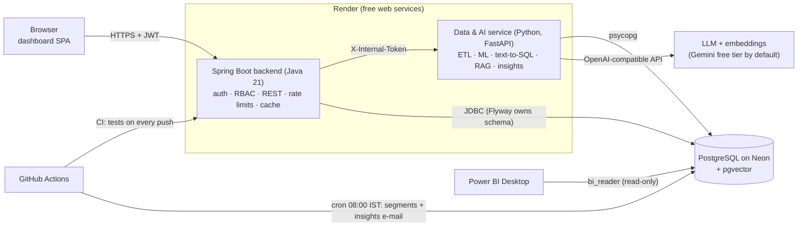
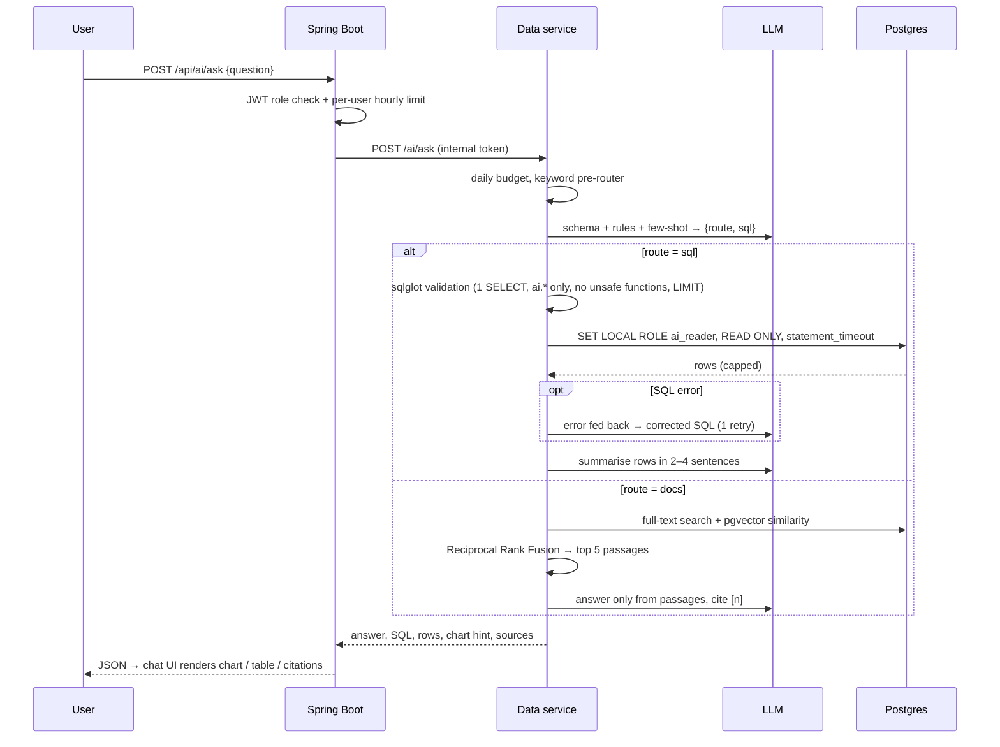

# Architecture

## System overview

**Why two services?** Java and Spring Boot handle what they are best at: authentication, role-based access, REST contracts and transactions. Python handles what its ecosystem is best at: pandas for messy data, scikit-learn, LLM tooling. The browser only ever talks to the Java backend. The Python service trusts nothing without the shared internal token, so all user-facing security lives in one place.

**One schema owner.** Every table, view and role is created by Flyway migrations in `backend/src/main/resources/db/migration`. The Python tests build their database from the same migration files, so both services always agree on the schema.

## Database layout

| Schema | Contents | Who uses it |
|---|---|---|
| `public` | OLTP tables: `customers`, `orders`, `order_items`, `products`, `employees`, `tickets`, `cities`, `regions`, `app_users`. Audit and feature tables: `etl_runs`, `etl_issues`, `customer_segments`, `segmentation_runs`, `insight_reports`, `rag_documents`, `rag_chunks`, `ai_queries` | backend, data service |
| `ai` | 7 denormalised, commented, PII-free views (`ai.orders`, `ai.order_lines`, `ai.customers`, `ai.products`, `ai.tickets`, `ai.employees`, `ai.customer_segments`) | the LLM (read only, via the `ai_reader` role) |
| `bi` | star schema: `fact_sales`, `fact_tickets`, `dim_date`, `dim_customer`, `dim_product`, `dim_geography`, `dim_employee` | Power BI (via `bi_reader`) |

## Phase 2: ETL pipeline

```mermaid
flowchart LR
    CSV[CSV upload / sample batch / CLI] --> X[Extract<br/>read as strings,<br/>normalise headers + aliases]
    X --> V[Validate<br/>required, types, enums,<br/>ranges, timelines]
    V --> C[Clean<br/>dates, ₹ amounts, %,<br/>city synonyms, casing]
    C --> R[Reference check<br/>business keys exist?]
    R --> DD[De-duplicate<br/>exact rows + duplicate keys]
    DD --> O[Outliers<br/>flag, don't drop]
    O --> LD[Load<br/>COPY → temp staging →<br/>INSERT … ON CONFLICT]
    LD --> A[(etl_runs / etl_issues)]
```

- **Idempotent:** natural business keys (`order_no`, `customer_email`, `sku`, `ticket_no`, `employee_code`) plus upserts, so re-running a file updates rows instead of duplicating them.
- **Atomic batches:** a multi-file batch is processed in dependency order (customers → products → employees → orders → order_items → tickets) inside one transaction, with a savepoint per file.
- **Dry run:** identical processing, then rolled back. The report is written on a separate autocommit connection, so it survives the rollback. Public demo accounts are always forced into dry-run mode by the backend.
- **Severity model:** `ERROR` rejects the row, `WARNING` loads it but flags it, `INFO` is informational. The quality score is clean rows ÷ rows in.

## Phase 2: Machine learning

`data-service/app/analysis/segmentation.py`:
1. RFM features per customer (recency, frequency, monetary), computed in SQL.
2. `log1p` + `StandardScaler`, then K-Means with k=4. Silhouette scores for k=3–6 are stored for transparency.
3. Clusters are named from centroid quadrants (recent/lapsed × high/low value): Champions, Promising, At Risk, Hibernating.
4. Churn risk compares each customer's days since their last order with their own average gap between orders.

## Phase 3: AI analyst

**Defence in depth for generated SQL:** (1) curated views, (2) AST validation, (3) a least-privilege role, (4) a read-only transaction that is always rolled back, (5) a timeout and row cap, (6) rate limits. Each layer is unit- or integration-tested in `data-service/tests/test_ai.py`.

**Graceful degradation:** with no LLM key configured, policy questions still work (keyword search plus extractive answers) and data questions return a clear message instead of failing.

## Phase 4: Automation, security and delivery

- **Daily insights** (`app/insights`): week-over-week KPIs, z-score anomalies against an 8-week baseline for regions, categories, cities, channels and products, SLA monitoring, an optional LLM-written executive summary, an HTML e-mail sent over SMTP, and storage in `insight_reports`.
- **Scheduling:** the GitHub Actions cron (`daily-insights.yml`) runs directly against Neon, so it works while the Render services sleep.
- **Roles:** `ADMIN`, `ANALYST`, `MANAGER` and `EMPLOYEE`, enforced in `SecurityConfig` (URL rules) and in controllers (`@PreAuthorize`, owner checks). There is also a demo/owner split: demo logins are public and can't change shared data.
- **CI/CD:** pull requests run the Java tests (Flyway on pgvector Postgres), the Python tests (built from the same migrations) and both Docker builds. Render's `autoDeployTrigger: checksPass` deploys `main` only after CI is green.

## Free-tier engineering

| Constraint | Design response |
|---|---|
| Render sleeps after 15 min idle | `/api/health` and `/health` never touch the DB. The login page shows wake-up progress, and the dashboard pings the AI service in the background right after login |
| Neon scales to zero (100 compute-hours a month) | Hikari `minimum-idle: 0`, a Caffeine cache (6 h), short-lived Python connections, no DB in health checks |
| 512 MB RAM | JVM: SerialGC, `MaxRAMPercentage=70`, C1 only. Python: one uvicorn worker, no LangChain |
| LLM free-tier quotas | per-user hourly limit (Java), global daily budget (Python), keyword pre-router to skip an LLM call for obvious policy questions |
