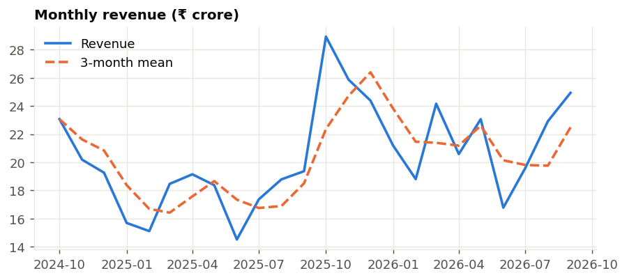
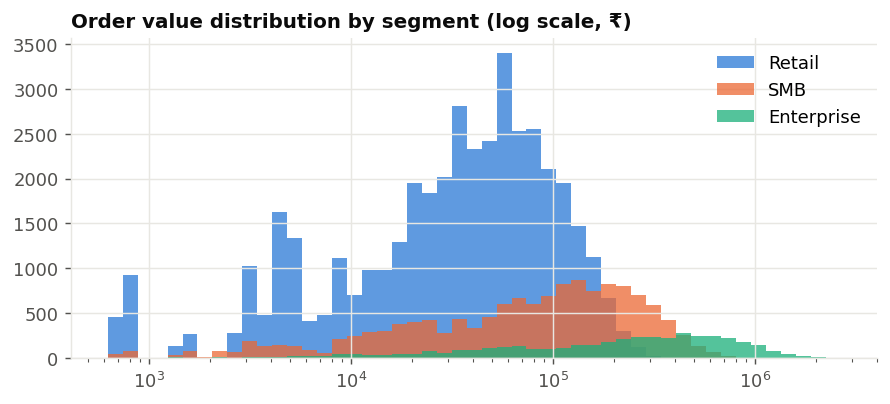
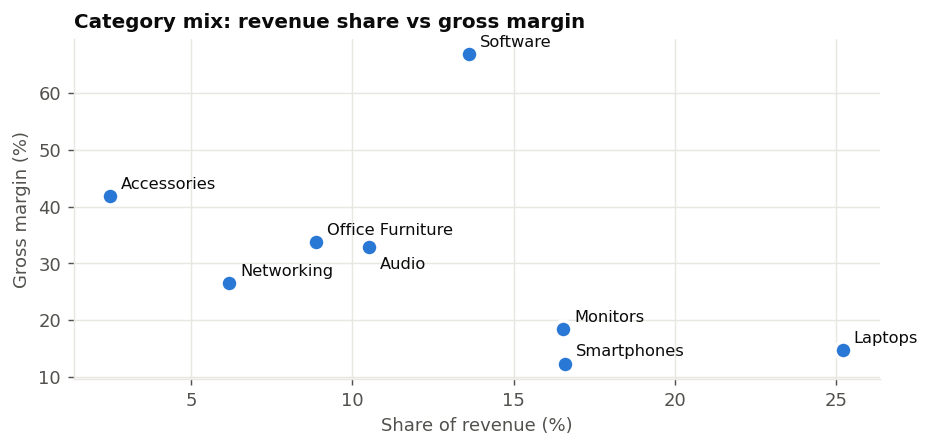
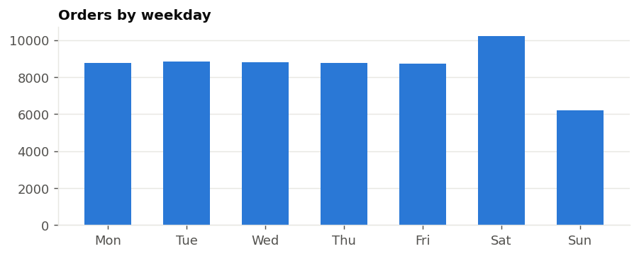
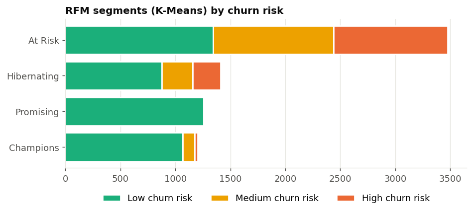

# Exploratory data analysis

Generated by `python -m app.analysis.eda` from the live database (pandas, NumPy, Matplotlib, scikit-learn).

## Key findings

- Revenue for the last 12 months is ₹271.2 Cr, +23.6% on the prior 12 months.
- The peak month is October 2025 (₹28.9 Cr), the festive season.
- Median order value: Retail ₹37,012, SMB ₹89,328, Enterprise ₹250,388.
- 4.1% of orders sit above the extreme-outlier fence (Q3 + 3·IQR = ₹356,818). These are bulk Enterprise orders, so they are real, not errors. That is why the ETL flags outliers instead of dropping them.
- Laptops bring the most revenue (25%) at only 15% margin. Software earns the highest margin (67%).
- Saturday has +16% more orders than an average weekday, and Sunday has -29%.
- 1,320 customers are at HIGH churn risk. Together they account for ₹83.6 Cr of lifetime revenue.

## Revenue trend

## Order values

## Category mix

## Weekly pattern

## Customer segments

